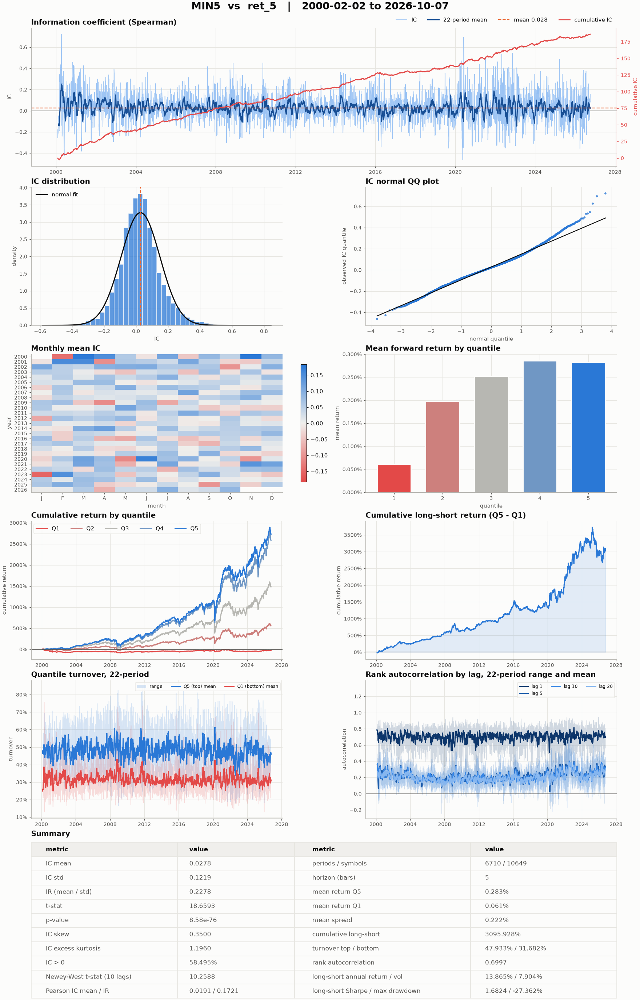

# Factors and labels

A factor turns the `(timestamp, symbol)` price panel of a dataset into a panel
of engineered features of the same shape. A label is a factor shifted forward
in time: the value a model learns to predict. This page covers the two
computation backends, computing and storing factors, the built-in factor
bundles, reading whole-market stores on a universe, normalisation and
neutralisation, resampling and the factor calendar, chunked builds, labels,
streaming and factor reports. Read it after [Datasets](datasets.md) and before
[Models](models.md).

## Factors, labels and panels

Every variable of a factor panel is one feature, such as a five-day return or
a volatility estimate, held as a `[timestamp, symbol]` array. A label panel
has the same shape and holds, at each `(timestamp, symbol)`, the value to
predict there, usually the return of the next few bars.

Every factor derives from {py:class}`~quantlab.factor.base.Factor` and is
built from a frozen config dataclass. The fields both backends share live on
{py:class}`~quantlab.factor.config.BaseFactorConfig`:

- `warmup_bars`: bars of history, counted on the dataset's own calendar, that
  `compute(start, end)` reads before `start`, so rolling computations have a
  full window on the first requested bar;
- `dataset`: the dataset the factor reads, or a list of datasets it merges
  (see [Merge several datasets](#merge-several-datasets));
- `file_path`: the Zarr store `build` writes and `read` reads;
- `factor_names`: the outputs to produce; left `None`, every name the class
  can produce;
- `kwargs`: free-form options a particular class reads, such as a horizon.

The config says what is computed, not when: the date range is an argument of
`compute`, `build` and `read`, and none of them changes the factor's config or
its dataset's. `get_config()` returns a dict that
{py:func}`~quantlab.core.component.rebuild` turns back into an equal factor.

## Choosing a backend

| | {py:class}`~quantlab.factor.kunquant.FactorKunQuant` | {py:class}`~quantlab.factor.polars.FactorPolars` |
|---|---|---|
| Config class | {py:class}`~quantlab.factor.config.FactorConfig` | {py:class}`~quantlab.factor.config.PolarsFactorConfig` |
| Logic | a graph of KunQuant operators, compiled to native code | a Polars lazy expression chain |
| Modes | batch (`compute`) and streaming (`cal_stream`) | batch only |
| Input column names | the shared names, listed in `data_columns` (a spot store's `Close` becomes `close`) | the store's own names; the shared names over a merged input |
| Output dtype | float32 | float64 |
| Cost | compiles each graph once, then loads it from a cache | none |

KunQuant is the main backend. It runs the same compiled graph over a whole
history in batch mode or one bar at a time in streaming mode, so a factor
validated in a backtest runs unchanged on live data, and it has the rolling
and cross-sectional operators the built-in libraries are built from.
Compilation needs a C++ compiler. Polars is the lighter path for research
factors that only ever run in batch, or whose computation is awkward as an
operator graph. Both produce the same kind of panel, so a model takes factors
from both at once.

## A price store to follow along

The examples share one small synthetic US-equity store with eight symbols and
120 business days, laid out as the Tiingo converter writes it: raw `open`,
`high`, `low`, `close` and `volume`, plus the split-adjusted `adjOpen` to
`adjVolume`.

```python
import numpy as np
import pandas as pd
import xarray as xr

from quantlab.dataset.config import DatasetConfig
from quantlab.dataset.stock import StockDataset

rng = np.random.default_rng(0)
symbols = [f"S{i:02d}" for i in range(8)]
dates = pd.bdate_range("2024-01-01", periods=120)
close = 50 * np.exp(np.cumsum(rng.normal(0, 0.02, (120, 8)), axis=0))
volume = rng.uniform(1e5, 1e6, (120, 8))
fields = {"open": close * 0.995, "high": close * 1.01, "low": close * 0.99,
          "close": close, "volume": volume}
fields |= {"adj" + k.capitalize(): v for k, v in fields.items()}   # adjOpen, ...
xr.Dataset({k: (("timestamp", "symbol"), v) for k, v in fields.items()},
           coords={"timestamp": dates, "symbol": symbols}).to_zarr("prices.zarr", mode="w")

price_config = DatasetConfig(zarr_file_path="prices.zarr", raw_data_dir_path="raw",
                             market="us_equity", frequency="1d")
dataset = StockDataset(price_config)
```

The store ends on 14 June 2024. One dataset object can feed several factors:
a factor asks it for a date range with `dataset.panel(start, end)`.

## Compute a factor

Compute three Alpha158 features from February to the end of the store:

```python
from quantlab.factor.config import FactorConfig
from quantlab.factor.predefined.alpha158 import Alpha158Stock

alpha = Alpha158Stock(FactorConfig(
    warmup_bars=20,
    dataset=dataset,
    mode="batch",
    data_columns=("adjOpen", "adjHigh", "adjLow", "adjClose", "adjVolume"),
    factor_names=("KMID", "ROC5", "STD20"),
    file_path="factors/alpha158.zarr",
    njobs=4,
))
panel = alpha.compute("2024-02-01", "2024-06-14")
print(dict(panel.sizes), list(panel.data_vars))
print(int(panel["STD20"].isel(timestamp=0).isnull().sum()))
print(dataset.bar_before("2024-02-01", 20))
```

```text
{'timestamp': 97, 'symbol': 8} ['KMID', 'ROC5', 'STD20']
0
2024-01-04 00:00:00
```

The panel starts on the requested 1 February. The inputs were read from
4 January, twenty bars earlier on the dataset's calendar, so `STD20` already
has a full window on the first bar and none of its values there is NaN. When
the dataset holds fewer bars before `start` than `warmup_bars`, `compute`
warns with the shortfall and starts from the first bar there is. `njobs` sets
the executor threads. Pinning `factor_names` keeps the compiled graph small;
unpinned, `factor_names` resolves to all 169 Alpha158 names. A model trains on
exactly the pinned names.

`compute` holds nothing: every call reads the dataset and runs the factor
again (the compiled library is cached).

## Build and read a factor store

`build(start, end)` computes a range once, writes it to `config.file_path` as
a Zarr store with one array per factor and records the range beside it.
`read(start, end)` then opens the store lazily and returns any range inside
the recorded one. `extend(end)` computes the bars after the recorded range,
warmed from the dataset's history, and appends them; the store's time, symbol
and variable axes widen as needed:

```python
alpha.build("2024-02-01", "2024-05-31")
print(alpha.store_range())
print(dict(alpha.read("2024-03-01", "2024-03-29").sizes))

try:
    alpha.read("2024-05-01", "2024-06-14")
except ValueError as e:
    print(e)

alpha.extend("2024-06-14")
print(alpha.store_range())
print(dict(alpha.read("2024-02-01", "2024-06-14").sizes))
```

```text
('2024-02-01', '2024-05-31')
{'timestamp': 21, 'symbol': 8}
Alpha158Stock.read(): the store at factors/alpha158.zarr covers 2024-02-01 to 2024-05-31, which does not contain 2024-05-01 to 2024-06-14. Extend it with extend(end) or rebuild it with build(start, end).
('2024-02-01', '2024-06-14')
{'timestamp': 97, 'symbol': 8}
```

`rewind(end)` is the inverse of `extend`: it drops the bars after `end` and
moves the recorded end back, so the next `extend` computes them again (for
bars computed from inputs that were wrong). `read` and `extend` refuse a store
that `build` did not write. `read(start, end, symbols=[...])` keeps only those
symbols, in the order given.

A store is written by its owner only, the factor whose outputs are every
variable of it. A factor pinned with `factor_names` to some outputs of a
shared store reads it, and its `build` and `extend` raise rather than replace
the store with a subset. A factor declares the stores it owns or reads with
`store_uses()`, which is what the [daily data update](data-update.md) and the
[live day](live.md) extend.

A model chooses between computing and reading with `factor_data_strategy` and
`label_data_strategy`: `"cal"` computes every factor over the model's range,
`"read"` reads the stores built earlier (see [Models](models.md)).

## Built-in factors

| Class | Backend | What it computes |
|---|---|---|
| {py:class}`~quantlab.factor.predefined.momentum.Momentum` | Polars | `Close_t / Close_{t-n} - 1`; the reference Polars factor, reads the spot store's `Close` |
| {py:class}`~quantlab.factor.predefined.alpha101.Alpha101SpotKline`, {py:class}`~quantlab.factor.predefined.alpha101.Alpha101Stock` | KunQuant | the 101 formulaic alphas of Kakushadze (2016) |
| {py:class}`~quantlab.factor.predefined.alpha158.Alpha158SpotKline`, {py:class}`~quantlab.factor.predefined.alpha158.Alpha158Stock` | KunQuant | the 169 features of Qlib's Alpha158: candle shapes (`KMID`), lagged prices (`CLOSE1`), rolling statistics over 5 to 60 bars (`ROC5`, `STD20`) |
| {py:class}`~quantlab.factor.predefined.residual_momentum.ResidualMomentumFF3` | KunQuant | Fama-French three-factor residual momentum, from a Fama-French CSV or from series on the panel |
| {py:class}`~quantlab.factor.predefined.barra.BarraStyle` | KunQuant | USE4-style exposures to 12 styles, their descriptors and the estimation-universe mask (see [Barra style factors](../dev/style-factors.md)) |
| {py:class}`~quantlab.factor.predefined.literature_alpha.LiteratureAlpha` | KunQuant | eight literature characteristics, raw and ranked (below) |
| {py:class}`~quantlab.factor.predefined.short_horizon.ShortHorizonAlpha` | KunQuant | short-horizon reversal, low MAX, turnover-conditioned momentum, abnormal volume, overnight and intraday returns |
| {py:class}`~quantlab.factor.predefined.fundamental_alpha.FundamentalAlpha` | KunQuant | 23 accounting, 13F and insider characteristics, reports lagged by fiscal period |
| {py:class}`~quantlab.factor.predefined.alternative_alpha.AlternativeAlpha` | KunQuant | short selling, news, 8-K events and 10-K text changes |
| {py:class}`~quantlab.factor.predefined.daily_anomaly_alpha.DailyAnomalyAlpha` | KunQuant | 20 daily anomalies: calendar effects, coskewness and downside beta, investor behaviour, corporate actions, listing age |
| {py:class}`~quantlab.factor.predefined.intraday.IntradayStats`, {py:class}`~quantlab.factor.predefined.intraday.IntradayAverage`, {py:class}`~quantlab.factor.predefined.intraday.IntradayComposite` | KunQuant | session statistics of one-minute bars, their trailing means, and rank composites of them |
| {py:class}`~quantlab.factor.predefined.market.MarketFeatures` | xarray | 21 return and amount features per index or ETF series, the same for every symbol with a bar |
| {py:class}`~quantlab.factor.predefined.benchmark_beta.BenchmarkBeta` | xarray | each symbol's rolling OLS beta on a single-symbol benchmark |
| {py:class}`~quantlab.factor.predefined.membership_cap_weight.MembershipCapWeight` | xarray | an index's capitalization weights from point-in-time membership |
| {py:class}`~quantlab.factor.predefined.dvol_regression.DvolRegressionStats`, {py:class}`~quantlab.factor.predefined.dvol_regression.DvolRegressionFactors` | xarray | each session's OLS of minute returns on the current and five lagged volume increments (intercept t-statistic, F, row count), and the 20-session mean of the intercept t-statistic sign-flipped by the day's market mean F |

Each class docstring shows its config and the columns it reads. A few notes:

- The `SpotKline` variants z-score every output along time over
  `kwargs["zscore_window"]` bars (default 20), which suits strategies that
  follow one asset; `warmup_bars` must cover the alpha's lookback plus
  `zscore_window - 1`. The `Stock` variants z-score across the symbols of each
  bar, and a symbol with no bar that day (not yet listed or delisted) is NaN in
  every output, so it enters neither the ranks nor the z-score. US-equity
  stores have no dollar-volume column, so the `Stock` variants use the typical
  price `(adjHigh + adjLow + adjClose) / 3` as VWAP.
- `FundamentalAlpha`, `AlternativeAlpha` and `DailyAnomalyAlpha` are signed so
  that higher predicts higher return; `kwargs={"ranked": True}` gives
  whole-market ranks, the input [`NeutralizedFactor`](#neutralise-against-industry-and-size)
  should wrap. Their `data_columns` must be the columns their parameters name
  (for example `DAILY_ANOMALY_COLUMNS`). All three are batch only.
- `MarketFeatures` gives every stock the market inputs the MASTER model uses.
  Its {py:class}`~quantlab.factor.config.MarketFeatureConfig` takes the stock
  dataset as `dataset` and a `series` dict of single-symbol datasets; values go
  to every symbol that has a bar on the date, so a symbol not yet listed stays
  NaN. `MASTERRegressor` takes the factor's names as its `gate_features`.
- `BenchmarkBeta`'s one output, `beta`, is the exposure a mean-variance book
  holds near 1 with exposure bounds, and `MembershipCapWeight`'s
  `benchmark_weight` is the book the active-risk optimizer prices active risk
  against (see [Portfolio construction](portfolio.md)).

### Literature-backed equity alpha bundle

`LiteratureAlpha`, contributed by [Jerry](https://github.com/j38903016-lgtm),
emits a raw value and a cross-sectional rank (`<stem>_raw`, `<stem>_rank`) of
eight characteristics: 52-week-high proximity, short-term reversal, low MAX,
low idiosyncratic volatility, Amihud illiquidity, gross profitability,
conservative asset growth and standardized unexpected earnings; the class
docstring defines each and cites its paper. Selecting a subset with
`factor_names` prunes unrelated formulas and the columns they need. The data
layer owns point-in-time correctness: accounting fields become visible only
after their filing is public, and the earnings columns freeze the actual EPS,
the consensus before the announcement and the scale price at the event.

### Volume-increment regression factor

`DvolRegressionStats` and `DvolRegressionFactors`, contributed by
@ Jiafan (Gavin) Liu, compute `flipped_intercept_t` from one-minute bars:
each session's OLS of the minute return on the current and five lagged
volume increments gives the intercept's t-statistic and the F statistic of
the six slopes, and the factor is the absolute intercept t-statistic,
negated when the session's F is below the day's market mean, averaged over
20 sessions. A large value marks sessions where the volume flow or noise
dominates the price, a very negative one a steady drift the volume flow does
not explain; lower is better. The module docstring defines the regression,
the guards and the scaling, all choices of the implementation.

## Compute on the whole market, read on a universe

Cross-sectional factors (ranks, z-scores, neutralisation) are computed on the
whole-market store of common stocks and read on a universe. A roster store,
the set of every symbol ever a member, would mix future members into early
cross-sections and change the factor's history whenever the index changes.
Two wrappers then read the whole-market store for one universe:

- {py:class}`~quantlab.factor.predefined.roster.RosterFactor` keeps the
  symbols of a roster dataset. `read` reads only those symbols; `compute`
  computes on the whole dataset and cuts afterwards.
- {py:class}`~quantlab.factor.predefined.membership_mask.MembershipMaskedFactor`
  sets a cell to NaN wherever the symbol is not a member on the bar's own date.
  A cross-sectional model (GATs, MASTER) takes every symbol with a finite
  feature at `t` as context, so without the mask its cross-section at `t`
  would hold symbols that join the index later. The mask goes on the computed
  factor, never on the prices, so a symbol that joins at `t` has a value at
  `t` from its full price history.

```python
from quantlab.factor.config import MembershipMaskedFactorConfig, RosterConfig
from quantlab.factor.predefined.membership_mask import MembershipMaskedFactor
from quantlab.factor.predefined.roster import RosterFactor

features = MembershipMaskedFactor(MembershipMaskedFactorConfig(
    factor=RosterFactor(RosterConfig(factor=alphas, roster=membership)),
    membership=membership,
))
```

Labels and predictions are masked by the same rule, with
{py:class}`~quantlab.label.predefined.membership_mask.MembershipMaskedLabel`
and {py:class}`~quantlab.model.predefined.membership_mask.MembershipMaskedPredictor`;
prices are not masked by membership, only through
{py:class}`~quantlab.dataset.bad_prints.BadPrintMaskedDataset` for bad prints.
See [Universes](universes.md) for rosters and membership.

{py:class}`~quantlab.factor.predefined.start_clipped.StartClippedFactor`
moves the start of `read` and `compute` to the first day of the wrapped
store, for a factor whose inputs start late (the minute-bar factors start in
2016) in a model that trains from 2000; the model's merged panel is NaN on
the earlier bars. The wrappers nest: wrap `StartClippedFactor(StartClippedConfig(factor=hf))`
in the `RosterFactor` above.

All three are factor views ({py:class}`~quantlab.factor.view.FactorView`).
A view keeps no store of its own (`store_path` is `None`), answers
`store_range()`, `store_uses()` and the calendar with the wrapped factor's,
and refuses `build`, `extend` and every other write. The outputs keep the
wrapped factor's names, so a view takes the factor's place in a model's
`factors`. The store itself is extended by the unpinned factor that owns it.

## Write your own factor

A Polars factor subclasses `FactorPolars` and overrides
`_get_factor_lazyframe`, which receives the dataset as a `polars.LazyFrame`
and returns one with exactly `timestamp`, `symbol` and the factor columns.
The factor names are read from the returned schema:

```python
import polars as pl
from quantlab.factor.config import PolarsFactorConfig
from quantlab.factor.polars import FactorPolars

class VolumeSurprise(FactorPolars):
    """Today's volume relative to its trailing mean, per symbol."""

    def _get_factor_lazyframe(self, lf: pl.LazyFrame) -> pl.LazyFrame:
        n = (self.config.kwargs or {}).get("n", 20)
        volume = pl.col("adjVolume")
        return (
            lf.sort(["symbol", "timestamp"])
            .with_columns(
                (volume / volume.rolling_mean(n).over("symbol") - 1.0)
                .alias(f"vol_surprise_{n}")
            )
            .select(["timestamp", "symbol", f"vol_surprise_{n}"])
        )

surprise = VolumeSurprise(PolarsFactorConfig(
    warmup_bars=10,
    dataset=dataset,
    kwargs={"n": 10},
    file_path="factors/vol_surprise.zarr",
))
print(surprise.get_factor_names())
print(dict(surprise.compute("2024-02-01", "2024-06-14").sizes))
```

```text
('vol_surprise_10',)
{'timestamp': 97, 'symbol': 8}
```

Sort by symbol and time and use `.over("symbol")` so windows stay within one
symbol, end with the `.select(...)` (any column left in the frame is stored
as a factor), and spell columns as the store does.

A KunQuant factor subclasses `FactorKunQuant` and implements
`_get_factor_names` and `_get_factor_func`, which builds an operator graph
with one `Input` per entry of `data_columns` and one `Output` per factor name;
the next section has one. KunQuant operators look only backwards in time, so
a graph cannot read the future by accident. [Extending quantlab](../dev/extending.md)
covers both backends in depth.

## Normalise and neutralise

`WindowedZScore(x, window)` in {py:mod}`quantlab.factor.kunquant_ts` compares
each symbol with its own trailing `window` bars; `CrossSectionalZScore(x)` in
{py:mod}`quantlab.factor.kunquant_cs` standardises each bar across symbols,
ignoring NaN. A strategy that ranks stocks against each other on the same day
wants the cross-sectional version; one that trades a single asset when it is
unusually high against its own history wants the time-series version. This
factor computes the close's distance from its ten-day mean in all three
forms:

```python
import KunQuant.ops as op
from KunQuant.Op import Builder, Input, Output
from KunQuant.Stage import Function
from quantlab.factor.kunquant import FactorKunQuant
from quantlab.factor.kunquant_cs import CrossSectionalZScore
from quantlab.factor.kunquant_ts import WindowedZScore

class MaDeviation(FactorKunQuant):
    """Distance of the close from its 10-day mean, raw and normalised."""

    def _get_factor_names(self):
        return ("ma_dev_10", "ma_dev_10_ts", "ma_dev_10_cs")

    def _get_factor_func(self):
        builder = Builder()
        with builder:
            close = Input("adjClose")
            dev = op.SubConst(op.Div(close, op.WindowedAvg(close, 10)), 1.0)
            Output(dev, "ma_dev_10")
            Output(WindowedZScore(dev, 20), "ma_dev_10_ts")      # along time
            Output(CrossSectionalZScore(dev), "ma_dev_10_cs")    # across symbols
        return Function(builder.ops)

ma_dev = MaDeviation(FactorConfig(
    warmup_bars=30, dataset=dataset, mode="batch",
    data_columns=("adjClose",), file_path="factors/ma_dev.zarr", njobs=4,
))
dev = ma_dev.compute("2024-02-15", "2024-06-14")
day = dev.isel(timestamp=-1)
print(round(day["ma_dev_10_cs"].mean().item(), 6), round(day["ma_dev_10_cs"].std(ddof=1).item(), 6))
print(np.round(day["ma_dev_10_cs"].values, 2))
```

```text
-0.0 1.0
[ 0.3  -1.5  -0.93  1.12 -0.87  1.27  0.27  0.35]
```

The same modules hold the other operators the built-in bundles use:
cross-sectional outlier handling
({py:class}`~quantlab.factor.kunquant_cs.CrossSectionalWinsorize`,
{py:class}`~quantlab.factor.kunquant_cs.CrossSectionalTrim`; a common chain
is `CrossSectionalZScore(CrossSectionalWinsorize(v))`), exponentially
weighted window statistics ({py:class}`~quantlab.factor.kunquant_ts.EWMean`,
{py:class}`~quantlab.factor.kunquant_ts.EWBeta` and relatives),
estimation-universe weighting and regressions
({py:class}`~quantlab.factor.kunquant_cs.CapWeightedStandardize`,
{py:class}`~quantlab.factor.kunquant_cs.CrossSectionalWLSResidual`) and
{py:class}`~quantlab.factor.kunquant_cs.CrossSectionalNeutralize`.

### Neutralise against industry and size

{py:class}`~quantlab.factor.predefined.neutralized.NeutralizedFactor` wraps a
factor and, on every bar, replaces each output by its residual from a
regression over every symbol on one intercept per industry plus a slope on the
log market cap, z-scored again across symbols. Its
{py:class}`~quantlab.factor.config.NeutralizedConfig` takes the wrapped
`factor`, an exposures `dataset` (one or a list merged) holding `marketcap`
and `industry`, and `regressors` (`("industry", "size")`, `("industry",)` or
`("size",)`). A symbol whose exposure is missing on a bar is NaN there, which
includes a secondary share class with no market cap of its own under size
neutralisation. Unlike a view it has a store of its own, so build it and use
it in a model's `factors` in place of the raw factor:

```python
from quantlab.factor.config import NeutralizedConfig
from quantlab.factor.predefined.neutralized import NeutralizedFactor

# daily, industry: the Sharadar DAILY (market cap) and industry datasets
alpha158_neutral = NeutralizedFactor(NeutralizedConfig(
    factor=alpha158, dataset=[daily, industry],
    file_path=str(store_path(FACTORS, "alpha158_neutral")), njobs=16,
))
```

Rank a characteristic across the market before neutralising it, which is
what `ranked=True` on the alpha bundles gives. `NeutralizedFactor` is batch
only and cannot be resampled.

## Merge several datasets

`dataset` also takes a list of datasets. The factor merges them into one
{py:class}`~quantlab.dataset.merged.MergedDataset`: each input is renamed to
the shared variable names, then the inputs are outer-joined on timestamp and
symbol, NaN where an input has no value. This covers an index store plus an
ETF store (same variables, different symbols) and prices plus fundamentals
(same symbols, different variables). Warm-up is counted on the union of the
inputs' calendars. A merge never picks a value by input order: a cell holding
a value in two inputs, or inputs on different bar spacings, raise
`ValueError`. A KunQuant factor over a merge lists the shared names in
`data_columns` (`close`, not `Close`); stream mode refuses a merge. Resample
the inputs before merging them.

## Resample a factor and the factor calendar

`resample(freq, how)` returns a copy of the factor whose `compute`, `read` and
`build` answer on coarser bars. The factor is still computed on its dataset's
own bars and only the output is aggregated, so a minute-bar momentum becomes
a daily series of the last minute's value. `freq` and `how` take the values of
the dataset's `resample` (see [Datasets](datasets.md)):

```python
>>> import numpy as np, pandas as pd, xarray as xr
>>> from quantlab.dataset.config import DatasetConfig
>>> from quantlab.dataset.spot import SpotKlineDataset
>>> from quantlab.factor.config import PolarsFactorConfig
>>> from quantlab.factor.predefined.momentum import Momentum
>>> minutes = pd.DatetimeIndex(np.concatenate([
...     pd.date_range(f"2024-01-0{d} 00:00", periods=4, freq="min").values for d in (2, 3)
... ]))
>>> minute_close = np.arange(1.0, 9.0)[:, None] * np.array([[1.0, 10.0]])
>>> _ = xr.Dataset(
...     {"Open": (["timestamp", "symbol"], minute_close - 0.5),
...      "Close": (["timestamp", "symbol"], minute_close),
...      "Volume": (["timestamp", "symbol"], np.ones((8, 2)))},
...     coords={"timestamp": minutes, "symbol": ["AAAUSDT", "BBBUSDT"]},
... ).to_zarr("data/minute_klines.zarr", mode="w")
>>> minute_config = DatasetConfig(raw_data_dir_path="downloads/spot",
...                               zarr_file_path="data/minute_klines.zarr",
...                               market="crypto_spot", frequency="1m")
>>> minute = Momentum(PolarsFactorConfig(
...     warmup_bars=1, dataset=SpotKlineDataset(minute_config),
...     file_path="data/factors/minute_momentum.zarr", kwargs={"n": 1},
... ))
>>> daily = minute.resample("1d", "last")
>>> daily.compute("2024-01-02", "2024-01-03")["momentum_1"].to_pandas().round(3)
symbol      AAAUSDT  BBBUSDT
timestamp                   
2024-01-02    0.333    0.333
2024-01-03    0.143    0.143
>>> daily.store_path
'data/factors/minute_momentum_resample_1d.zarr'
```

`build()` on the copy writes its own store beside the source store; `read()`
opens that store when it exists and otherwise resamples the source factor's
store on read. The built resampled store is a cache: rebuilding the source
factor does not refresh it. To compute a factor on already-resampled bars
instead, give the factor a resampled dataset.

A factor answers for its own bars, the *factor calendar*, through
{py:meth}`~quantlab.factor.base.Factor.calendar`,
{py:meth}`~quantlab.factor.base.Factor.bar_before` and
{py:meth}`~quantlab.factor.base.Factor.bar_after`, with the rules of the
dataset methods of the same names. A factor that is not resampled answers with
its dataset's calendar; a resampled factor answers with its resampled bars, so
a daily factor computed from minute bars moves by trading days:

```python
>>> daily.calendar("2024-01-02", "2024-01-03")
DatetimeIndex(['2024-01-02', '2024-01-03'], dtype='datetime64[ns]', freq=None)
>>> minute.bar_before("2024-01-03", 1), daily.bar_before("2024-01-03", 1)
(Timestamp('2024-01-02 00:03:00'), Timestamp('2024-01-02 00:00:00'))
>>> minute.bar_after("2024-01-02", 1), daily.bar_after("2024-01-02", 1)
(Timestamp('2024-01-02 00:01:00'), Timestamp('2024-01-03 00:00:00'))
```

A wrapper answers with the calendar of the factor it wraps, never with its own
dataset's: a `RosterFactor` over `daily` gives the daily bars, and
`NeutralizedFactor` the neutralised factor's bars, not its exposures'. A
factor over a merged dataset answers with the union calendar. `warmup_bars`
alone is counted on the dataset's calendar, because it says how much input to
read.

## Build a store that does not fit in memory

{py:class}`~quantlab.factor.chunking.ChunkedBuilder` builds and extends a
factor's own store one chunk of time at a time. It is a build tool, not a
factor: it writes only through the factor's public write entries, and a model
reads the factor itself. With `granularity=None` it computes the range whole
when its peak fits in half the available memory and otherwise cuts it at the
coarsest period (`"year"` down to `"hour"`) whose largest chunk fits. The
first chunk is the factor's `build`, each later one its `extend`, so a build
that fails part way keeps the finished chunks and `extend(end)` resumes it.
Joined, the chunks equal the whole range computed at once to within
float32 tolerance.

```python
from quantlab.factor.chunking import ChunkedBuilder
from quantlab.factor.config import FactorConfig
from quantlab.factor.predefined.alpha158 import Alpha158Stock

alpha158 = Alpha158Stock(FactorConfig(
    warmup_bars=400, dataset=RosterDataset(sep, membership), mode="batch",
    data_columns=("adjOpen", "adjHigh", "adjLow", "adjClose", "adjVolume"),
    file_path="factors/alpha158.zarr", njobs=32,
))
ChunkedBuilder(alpha158).build("2016-01-01", "2026-10-02")
features = alpha158.read("2026-01-02", "2026-10-02")
```

On us3000 (3103 bars x 7625 symbols, yearly chunks) this build peaked at
3.0 GB against 13.8 GB whole. `workers` computes several chunks at once in
worker processes while this process writes them in time order. Workers pay
off where a chunk's time goes outside the factor's own threads (reading,
decompressing, mapping minute bars); a factor whose time is in its KunQuant
graph already fills the cores with `njobs`. A resampled factor is chunked on
its source bars, never finer than its resampled bars.

The minute-bar factors are the main use. `IntradayStats` computes each
session's statistics of the one-minute Massive bars (see
[Massive](massive.md)): realised volatility and higher moments, jumps,
intraday and overnight returns, VWAP distance, order imbalance, volume shares
and trade size, each the statistic of the session so far. Resampled to `"1d"`
with `"last"` it is one value per stock and session; `IntradayAverage`
averages a stored factor over its last sessions. The daily store of ten
years of minute bars is built with
`ChunkedBuilder(daily, granularity="month", workers=24)`, where `daily` is
`IntradayStats(...).resample("1d", "last")`.

On the training server 24 workers of 4 threads built ten years of the S&P 500
roster's minute statistics in 645 s. `IntradayComposite` combines trailing
means or coefficients of variation of stored outputs into equal-weight rank
composites, each part named `"[-]<output>:<mean|cv>:<window>"`; its ranks are
taken over every symbol of the wrapped panel, so build it on the whole market
and read it on a roster.

## Labels

{py:class}`~quantlab.label.forward.Forward` wraps any factor and places the
factor's value at bar `t + delay + span` at bar `t`. Its
{py:class}`~quantlab.label.config.ForwardConfig` takes:

- `factor`: the factor to shift. Its value at `t` must use only bars up to
  `t`; `Forward` relies on this and cannot check it.
- `span`: the bars the label accumulates over, such as the `n` of an `n`-bar
  return.
- `delay`: the bars between the bar a signal forms on and the first bar the
  label counts, 1 by default, because a signal formed at the close of bar `t`
  fills at the open of bar `t + 1`.

`delay + span` is the label's lookahead, `lookahead_bars()`. `read` and
`compute` ask the wrapped factor for `lookahead` bars past `end`, counted on
the factor calendar (a factor resampled to daily counts trading days), then
shift and trim back to the request. The label is therefore NaN at the end of a
range only where the later bars do not exist. A `Forward` owns no store:
`build`, `extend` and `read` act on the wrapped factor's store, which then
serves as a feature and, wrapped, as a label.

### Forward-return labels

{py:mod}`quantlab.label.predefined.fret` provides three `Forward` subclasses
with `span = n` and `delay = 1`, reading `adjOpen` and taking `n` from
`kwargs["n_forward_periods"]`:

- {py:class}`~quantlab.label.predefined.fret.Return`, the regression target
  `ret_{n}`: the return from the open of bar `t + 1` to the open of bar
  `t + n + 1`.
- {py:class}`~quantlab.label.predefined.fret.BinaryReturn`, the
  classification target `ret_binary_{n}`: 1.0 when that return is positive,
  0.0 otherwise, NaN exactly where `Return` is NaN (an open inside the span
  is missing, or the later bars do not exist).
- {py:class}`~quantlab.label.predefined.fret.Volatility`, `vol_{n}`: the
  sample standard deviation of the one-bar open-to-open returns over the same
  opens, times `sqrt(n)`, for a model that forecasts risk.

```python
from quantlab.label.predefined.fret import BinaryReturn, Return

ret = Return(FactorConfig(
    warmup_bars=5, dataset=dataset, mode="batch",
    data_columns=("adjOpen",), kwargs={"n_forward_periods": 5},
    file_path="labels/ret_5.zarr", njobs=4,
))
print(ret.get_factor_names(), ret.span_bars(), ret.lookahead_bars())

labels = ret.compute("2024-02-01", "2024-05-31")
print(dict(labels.sizes), int(labels["ret_5"].isnull().sum()))

o = xr.open_zarr("prices.zarr")["adjOpen"]
t = o.get_index("timestamp").get_loc(pd.Timestamp("2024-05-31"))
print(float(labels["ret_5"].sel(timestamp="2024-05-31")[0]),
      float(o[t + 6, 0] / o[t + 1, 0] - 1))

tail = ret.compute("2024-06-01", "2024-06-14")
print(tail["ret_5"].isnull().all("symbol").values)

up = BinaryReturn(FactorConfig(
    warmup_bars=5, dataset=dataset, mode="batch",
    data_columns=("adjOpen",), kwargs={"n_forward_periods": 5},
    file_path="labels/up_5.zarr", njobs=4,
))
print(up.get_factor_names(), np.unique(up.compute("2024-02-01", "2024-05-31")["ret_binary_5"].values))
```

```text
('ret_5',) 5 6
{'timestamp': 87, 'symbol': 8} 0
0.04027259349822998 0.04027256300341486
[False False False False  True  True  True  True  True  True]
('ret_binary_5',) [0. 1.]
```

The range ending on 31 May has no NaN: its last labels read the June bars,
and the value on 31 May matches the hand computation up to float32 rounding.
In the range ending on 14 June, the store's last bar, the last six bars have
no six later bars and are NaN.

### Wrap any factor

Any factor that uses only bars up to `t` becomes a label by wrapping it.
The label keeps the factor's variable names, so the `VolumeSurprise` factor
above, wrapped, is the volume surprise five bars after the fill bar:

```python
from quantlab.label.config import ForwardConfig
from quantlab.label.forward import Forward

future_surprise = Forward(ForwardConfig(factor=surprise, span=5))
```

The same `surprise` can be a feature of one model while `future_surprise` is
the label of another.

### Mask a label by membership

A model trained on an index masks its label with the index's point-in-time
membership, judged at `t` only.
{py:class}`~quantlab.label.predefined.membership_mask.MembershipMaskedLabel`
wraps a label computed on unmasked prices and sets a cell to NaN only where
the symbol is not a member on `t`'s own date. A symbol that leaves the index
inside the label's horizon keeps its return at `t`; masking the prices
instead would drop the label wherever the symbol had left by the endpoint,
and since stocks usually leave an index after falling, that removes the
losers from the target (survivorship bias). A bar the membership panel does
not cover is refused. The wrapper owns no store and changes nothing else, so
it drops into a model's `labels` and into `analyze(frets=...)` in place of
the label it wraps:

```python
from quantlab.label.predefined.membership_mask import (
    MembershipMaskedLabel, MembershipMaskedLabelConfig,
)

label = MembershipMaskedLabel(MembershipMaskedLabelConfig(label=ret, membership=membership))
```

A model takes labels (anything with `lookahead_bars()`) only in its `labels`
and refuses them among its `factors`. At every split boundary it purges the
last `L` bars of the earlier segment, `L` being the largest lookahead among
its labels, so no label used for fitting reads a bar of the later segment. A
backtest refuses a label whose `delay` differs from its engine's fill delay.
See [Models](models.md) and [Backtesting](backtesting.md).

## Streaming mode

In streaming mode a KunQuant factor is compiled for one bar at a time and
keeps its rolling state between calls; this is how a factor runs on live
data. Build the factor with `mode="stream"`, pin the symbol list on the
dataset config, and feed one `float32` array per input column to
`cal_stream`. Here the whole history is replayed, and the last streamed bar
matches the batch result of `MaDeviation` above:

```python
from dataclasses import replace

stream_config = replace(price_config, symbols=tuple(symbols))
live = MaDeviation(FactorConfig(
    warmup_bars=30, dataset=StockDataset(stream_config), mode="stream",
    data_columns=("adjClose",), factor_names=("ma_dev_10", "ma_dev_10_ts"),
    njobs=4,
))
history = xr.open_zarr("prices.zarr")["adjClose"].values.astype("float32")
for step, row in enumerate(history):
    latest = live.cal_stream({"adjClose": np.ascontiguousarray(row)}, step, symbols)

print(dict(latest.sizes))
print(np.round(latest["ma_dev_10"].values[0], 4))
print(np.round(dev["ma_dev_10"].values[-1], 4))
```

```text
{'timestamp': 1, 'symbol': 8}
[-0.0137 -0.0654 -0.049   0.0099 -0.0472  0.0142 -0.0145 -0.0122]
[-0.0137 -0.0654 -0.049   0.0099 -0.0472  0.0142 -0.0145 -0.0122]
```

`cal_stream` returns the panel of the bar it was fed; the stream is compiled
on the first call or with `init_stream()`. Every column in `data_columns`
must be used by one of the requested outputs, because KunQuant drops unused
inputs from the compiled stream. Polars factors, resampled factors and
factors over a merged dataset do not stream.

## Analyse a factor

{py:meth}`~quantlab.factor.base.Factor.analyze` reports how well a factor
orders symbols by their forward return, in the manner of alphalens. Pass one
or more forward-return labels as `frets`; every factor variable is paired with
every label variable. With `data_strategy="read"` both are read from their
stores instead of computed.

```python
fwd = Return(FactorConfig(
    warmup_bars=5, dataset=dataset, mode="batch",
    data_columns=("adjOpen",), kwargs={"n_forward_periods": 1},
    file_path="labels/ret_1.zarr", njobs=4,
))
result = surprise.analyze("2024-02-01", "2024-05-31", frets=[fwd], quantiles=4,
                          output_dir="reports/vol_surprise")
print(list(result.pairs))
print(result.summary()[["factor", "fret", "ic", "rank_ic", "turnover"]].round(4))
```

```text
['vol_surprise_10__ret_1']
            factor   fret      ic  rank_ic  turnover
0  vol_surprise_10  ret_1  0.0061   0.0118    0.7762
```

On random prices the IC is near zero, as it should be.

### Read the analysis results

The returned {py:class}`~quantlab.analysis.factor_report.FactorAnalysis` holds
all results. {py:class}`~quantlab.analysis.factor_report.FactorAnalyzer` performs
the calculations; you do not need to construct one when calling `factor.analyze`.
Each entry in `result.pairs` is a {py:class}`~quantlab.analysis.factor_report.PairAnalysis`
for one factor and one forward-return target (`fret` in column and argument names).
For DataFrames, `qa.analyze_factors` returns a `FactorReport` whose `.raw` is
this same `FactorAnalysis` result.

| Compact `summary()` column | Detailed `summary_table()` column | Meaning |
|---|---|---|
| `ic` | `pearson_ic_mean` | Mean cross-sectional Pearson correlation |
| `rank_ic` | `ic_mean` | Mean cross-sectional Spearman rank correlation |
| `icir` | `pearson_ir` | Mean Pearson IC divided by its standard deviation |
| `rank_icir` | `ir` | Mean rank IC divided by its standard deviation |
| `long_short_return` | `mean_spread` | Mean forward return of the top group minus the bottom group |
| `turnover` | Average of `mean_turnover_top` and `mean_turnover_bottom` | Fraction of symbols newly entering the top and bottom groups per bar |

The compact return is a fraction over the target's **full holding horizon**,
not an annualized return: `0.01` means 1% over that horizon. IC ratios also
have no annualization multiplier. Annualized return and volatility fields
are named explicitly in the detailed table. Turnover measures group membership,
so it is different from the trading-notional turnover of a simulated portfolio.
Undefined statistics are NaN; an IC ratio can be infinite for zero dispersion.


Each pair gets the information analysis (per-period rank IC and Pearson IC,
their mean, IR, t-statistic and a Newey-West t-statistic `ic_nw_t_stat`,
which is the one to read for a label spanning several bars), the returns
analysis (mean forward return per quantile, top-minus-bottom spread,
cumulative and annualised long-short statistics) and turnover (quantile
turnover and rank autocorrelation at several lags). With frets of several
horizons, `ic_decay_table()` lists the mean IC by horizon; read beside the
autocorrelation, it suggests a holding period. With two or more factor
variables the result also carries `correlation`, a
{py:class}`~quantlab.analysis.factor_correlation.FactorCorrelation` of the
variables' rank correlations, clustered so near-duplicate factors fall
together.

With `output_dir`, the tables are written as CSV, the scalar metrics as
`summary.json`, one figure per pair as `<factor>__<fret>.png`, and the
factor's and labels' configs beside them. `plot=False` draws no figure, which
saves most of the time of a report over many factors.



{py:class}`~quantlab.analysis.factor_report.FactorAnalyzer` holds the
machinery and its options; its `analyze_panels` and
{py:func}`quantlab.api.analyze_factors` analyse panels that come from no
factor object.

## Things to watch

- `warmup_bars` counts bars on the dataset's calendar, so weekends and
  holidays are skipped, not counted. Set it to at least the longest lookback
  in the graph; a window nested in another needs the sum of both lengths.
- A KunQuant graph's `Input` names must match `data_columns`, which name
  variables of the store: a US-equity graph reads `adjClose`, not `close`.
- A Polars factor that names a column its store lacks fails when the object
  is constructed, because the factor names are derived by running the
  expression on a few rows; the store must exist before you build the factor.
- On macOS, batch mode pads the symbol axis to a multiple of 8 with all-NaN
  symbols and cuts them back, so any count runs; Linux needs no padding.
- `CrossSectionalZScore` is NaN on a bar with fewer than two valid values or
  zero spread, and a batch run must start at bar 0, which `compute()` always
  does.
- Compiled KunQuant libraries are cached in the process and on disk under
  `$QUANTLAB_KUNQUANT_CACHE`, else `$XDG_CACHE_HOME/quantlab/kunquant`, else
  `~/.cache/quantlab/kunquant`; the key covers the graph, the compiler and the
  quantlab operator sources, so a change compiles again. Delete the directory
  to clear it.

## See also

- [Datasets](datasets.md) for the panels factors read, and
  [Universes](universes.md) for rosters and point-in-time membership.
- [Models](models.md) for training on factors and labels.
- [Extending quantlab](../dev/extending.md) for writing factor classes.
- The {py:mod}`quantlab.factor` and {py:mod}`quantlab.label` API reference.
